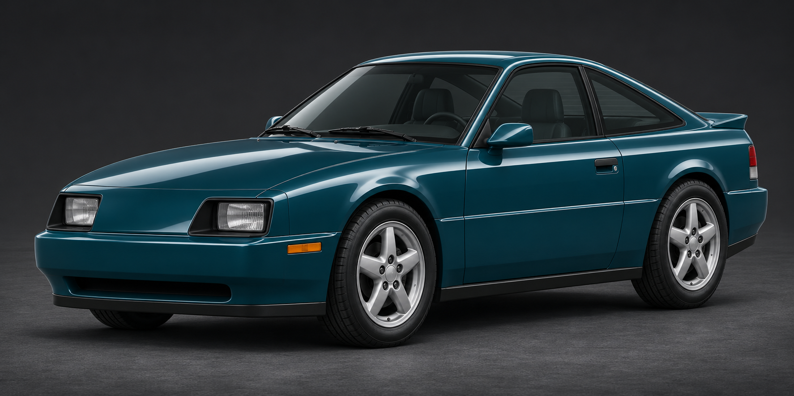

# Blue-green GT studio look

## Use the look on another car

For the default studio look, use the bundled image for lighting, camera, and setting. If the user supplies a design image, pass it as a separate design reference and name each image's role in the prompt. Use the body shape, paint color, and finish from the brief. For example, a matte red wagon keeps its long roof and matte red paint under the GT studio lights.

Replace the bracketed text with the current brief.

> Show [car description and defining features] in [paint color and finish]. Use the GT studio image for the lighting, camera, and setting. Use the proportions, roofline, lamps, and wheels from the car brief. Frame the entire car from a low front three-quarter angle with mild perspective. Use broad studio lights to reveal the hood and fenders. Match the reflections to the specified paint finish. Keep the tire edges, rubber seals, and lamp lenses visible. Use a dark neutral background, a lightly textured charcoal floor, and soft shadows where the tires touch the floor.

## Original GT studio prompt

The original prompt used a side view to define the GT's shape. The studio image above is the reference to use for other cars.

> Render a front-left three-quarter studio view of the exact same original petrol-blue fastback GT shown in the attached side reference. Use the attachment as the design reference. Preserve the long sloped hood, flat rectangular recessed headlamp housings, small amber corner markers, slim B-pillar, triangular rear quarter glass, door seam, body-color bumpers, black sill, five-spoke silver wheels and short raised rear lip. Set the wheels straight. For the unseen front, design two simple rectangular recessed headlamp units and a shallow central lower intake in a body-color bumper. Preserve the quiet body surfaces. Use the look of a carefully modeled vehicle for a driving game: glossy solid paint, broad clean studio reflections, visible tire sidewalls, dark rubber seals and a dim interior. Use a dark neutral backdrop above a lightly textured charcoal floor, soft contact shadows, low camera, mild perspective, whole car visible, generous margin. Keep the lamp lenses visible with the lamps switched off. No captions, badges, people or other cars.
